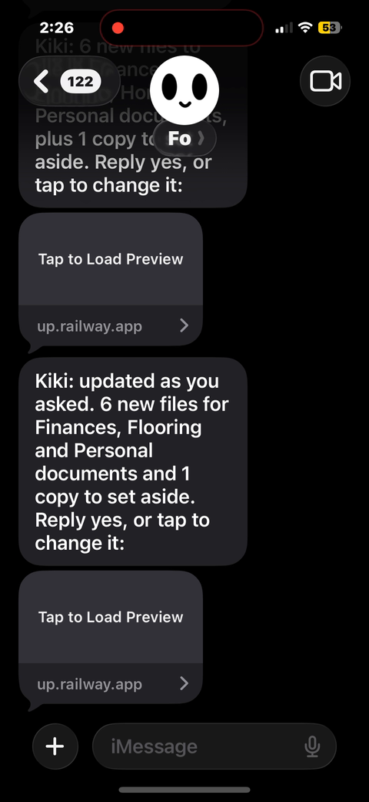
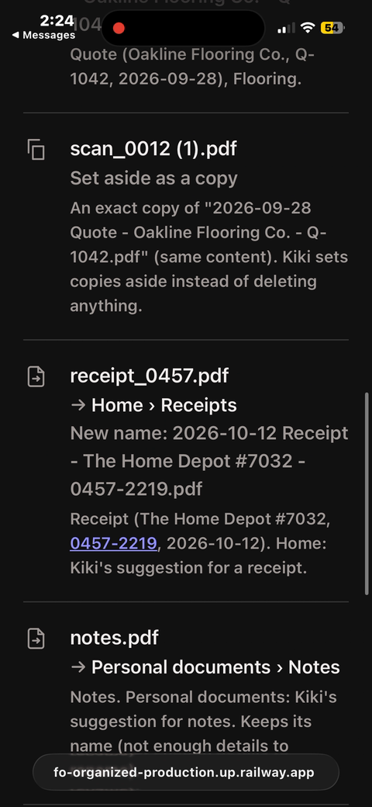
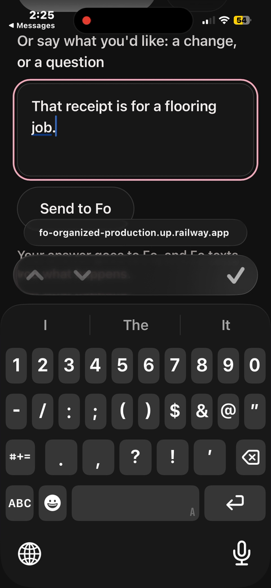
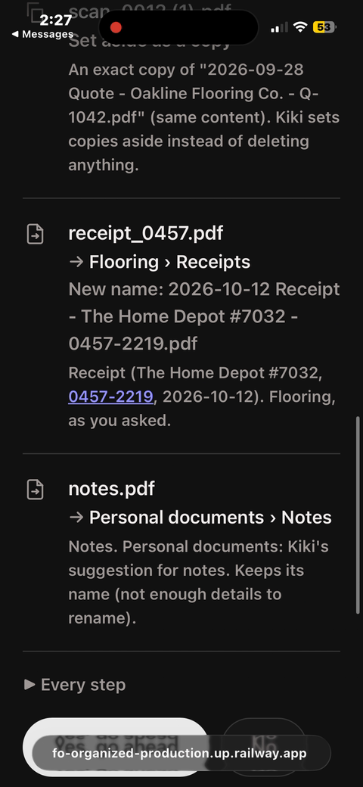
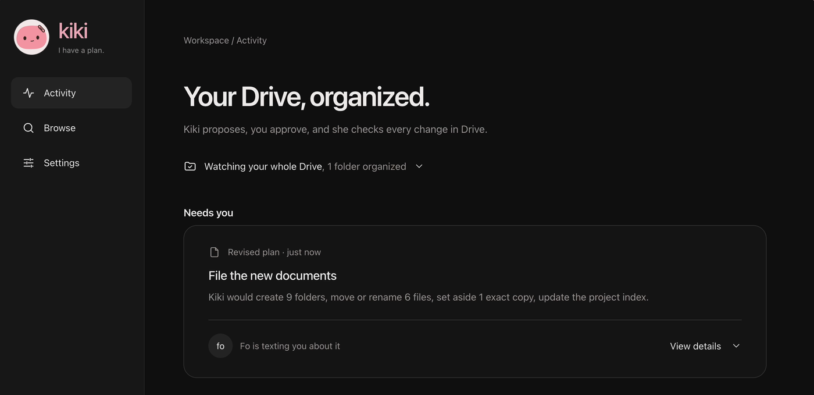
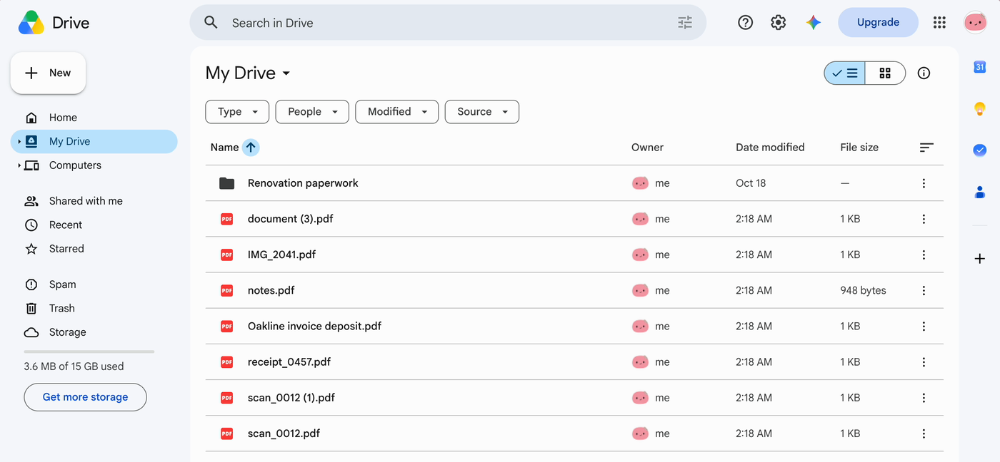
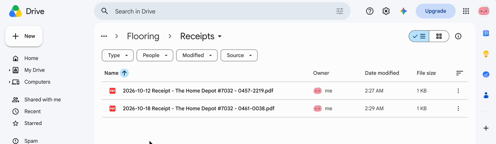
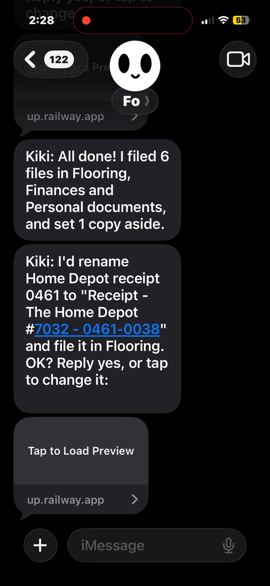
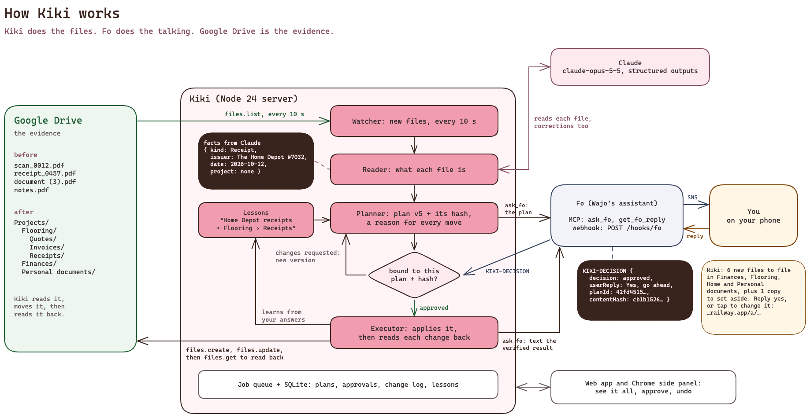

<p align="center">
  &nbsp;&nbsp;&nbsp;
</p>

# Kiki - your Drive, organized

<p><b>#stay fo-organized</b></p>

Kiki is a Google Drive agent that keeps your files organized, and Fo (Wajo's assistant) is how you talk to her. She reads every file you drop into Drive, figures out where it belongs and gives it a name you'll actually be able to find later. Then Fo texts you her plan. You answer the way you'd answer a friend, and Kiki only changes what you said yes to.

Everyone's Drive ends up full of `scan_0012.pdf`, `document (3).pdf` and `IMG_2041.pdf`. I built Kiki in three days so that nobody has to sort that by hand again.

[How Kiki works](#how-kiki-works)  [What I tested](#what-i-tested)  [Try it](#try-it)  [Design](docs/KIKI-DESIGN.md)

## What Kiki does

Kiki watches your whole Drive (or one folder, if you'd rather). When new files show up, she:

1. **Reads them.** Claude reads what's actually inside: a quote, an invoice, a receipt, a bank statement, a résumé, a screenshot. Who it's from, the date, the reference number.
2. **Makes a plan.** Folders, clear names like `2026-10-12 Receipt - The Home Depot #7032 - 0457-2219.pdf`, and a reason for every move. Exact copies get set aside, never deleted.
3. **Asks you through Fo.** Fo texts you a short summary with a link to the full plan.
4. **Listens.** Say yes, say no, or just tell her what's wrong ("That receipt is for the flooring job.") and she makes a new version with only that change.
5. **Does it and checks it.** She applies only the version you approved, reads every change back from Drive, and Fo texts you once it's really done.

What makes Kiki different:
- She learns from your corrections, so she asks less over time.
- Your answer is tied to the exact version of the plan you saw, so a yes can never approve something else.
- She never says "done" until Drive confirms it.
- She never deletes anything.

Kiki and Fo each have one job:

| Who | What they do |
|---|---|
| Kiki | Reads, plans, applies and checks. She never messages anyone herself. |
| Fo | Texts you and brings your answer back to Kiki. Fo never touches your files. |
| You | Decide. Nothing changes in Drive without your yes. |

## What it looks like

**On your phone:** Fo texts you, you tap through, and you can correct her in plain words.

<table>
  <tr>
    <td align="center"><br><sub>Fo texts you the plan</sub></td>
    <td align="center"><br><sub>She gets one wrong</sub></td>
    <td align="center"><br><sub>You tell her</sub></td>
    <td align="center"><br><sub>She fixes just that</sub></td>
  </tr>
</table>

**Kiki's app:** what needs you, what she's working on, and everything she did.


**Drive, before and after.** Seven files dropped at the top of My Drive...


...filed into `Projects/Flooring/Quotes`, `Invoices` and `Receipts`, `Finances` and `Personal documents`, renamed and read back.


## How she learns

When you correct Kiki, she remembers. In my demo she guessed that a Home Depot receipt belonged in Home. I told her "That receipt is for a flooring job." She moved it to Flooring › Receipts and saved a lesson: Home Depot receipts go in Flooring › Receipts. When the next Home Depot receipt showed up, she proposed Flooring on her own ("The Home Depot #7032's other document is in Flooring").

<p align="center"><br><sub>The next receipt, filed right the first time</sub></p>

Once she's filed the same kind of file the same way twice with your yes, she offers to do it on her own from now on. Only a plain yes turns that on, she still texts you every time, and you can switch it off or make her forget a lesson in **Settings → What Kiki learned**.

## How Kiki works



- **Kiki** is a Node 24 server written in TypeScript (no build step). Everything she keeps lives in SQLite: plans, approvals, a change log and lessons. A durable job queue runs the work, so a restart picks up where she left off.
- **Google Drive:** Kiki lists new files every 10 seconds and reads them. After you approve, she creates folders, moves and renames files, and reads each change back with `files.get` before she counts it.
- **Claude** (claude-opus-5-5, structured outputs checked with zod) reads each document, turns your corrections into plan changes, writes the texts and learns filing rules. Code checks what the model writes before it's used.
- **Fo:** Kiki calls Fo's MCP server (`ask_fo`, `get_fo_reply`) with the exact plan and a binding (`planId` + `contentHash`). Fo texts you, and your answer comes back as one `KIKI-DECISION` line with that binding. When you reply by text, Wajo's signed webhook (`POST /hooks/fo`) tells Kiki right away.
- **The web app** (React 19 + Vite) and the **Chrome side panel** show the same things: what needs you, what she's doing and what she did.

The diagram's source is [docs/diagrams/architecture.excalidraw](docs/diagrams/architecture.excalidraw).

## What I tested

I wanted to make sure Kiki reads things right and never changes anything you didn't approve:
- **Reading:** 190/190 fields right and 0 invented on the reading set ([step 1](docs/evals/step-1-reading.md)).
- **Organizing:** 33/33 files in the right place, 9/9 groups, 0 unnecessary changes ([step 2](docs/evals/step-2-organize.md)).
- **Answers:** 19/19 requested changes found in people's replies, 0 invented ([step 3](docs/evals/step-3-decisions.md)).
- **Real runs:** I ran the whole thing 24 times on real Drive, Fo and Claude, and 21 succeeded. All 3 failures were on the first day: Google wouldn't let Kiki move files she hadn't created under the narrow Drive permission. She reported "0 of 2 steps verified" instead of pretending it worked. Switching to the full Drive scope fixed it.
- **485 automated tests** (`npm test`), including replays, restarts and double taps that must never make duplicates.

## Try it

You need Node 24. Mock mode needs no accounts and no keys.

```bash
npm install
npm run start:mock   # everything simulated and labelled Mock: no Google, Claude or Fo calls
npm start            # the real thing, on http://localhost:8787
```

Open http://localhost:8787, connect Google Drive and Fo, then choose **Watch my whole Drive** (Kiki files loose files and leaves your own folders alone) or paste a folder link. **Set up the demo folder** adds a few messy files to play with.

In the app:
- **Activity**: what needs you, what needs a look, what she's working on, and everything she did (with Undo on finished plans).
- **Browse**: your folders and every file Kiki knows about.
- **Settings**: Google and Fo, texts, email, the folder she watches, light or dark, and **What Kiki learned**.

## Connect Google Drive

1. In the [Google Cloud Console](https://console.cloud.google.com), create a project and enable the **Google Drive API**.
2. Set up the OAuth consent screen (External, Testing) and add your Google account as a test user.
3. Create an OAuth client of type **Web application** with this redirect URI: `http://localhost:8787/api/google/oauth/callback`
4. Put the client ID and secret in `.env` (see below), with your `ANTHROPIC_API_KEY`. `.env` is never committed.
5. Restart Kiki and press **Connect Google Drive**. In Testing mode Google's consent lasts 7 days, so reconnect once a week (or publish the consent screen).

Kiki asks for the full `drive` scope. The narrower scopes can't move files you uploaded yourself, and what Kiki touches is limited by the app, not by the scope.

## Connect Fo

Press **Connect Fo** and sign in with your Wajo account, or put a Wajo API key (`wak_…`, from wajo.ai/user/api-keys) in `.env` as `FO_API_KEY`.

**Answering from your phone.** Each text ends with a link to a small page for that one plan: Yes, No, or a change in your own words. Your phone has to reach Kiki for that, so either run her online (below) or give her a public address with a tunnel:

```bash
brew install cloudflared
cloudflared tunnel --url http://localhost:8787   # prints https://<random>.trycloudflare.com
# then in .env:  KIKI_PUBLIC_URL=https://<random>.trycloudflare.com  and restart Kiki
```

Only the answer pages and Fo's webhook are public. Each link is an unguessable one-time token.

**Replying to the text itself.** Add a webhook in Wajo (Settings → Fo MCP → Webhooks) pointing at `<your public address>/hooks/fo`. Put the signing secret it shows you in `.env` as `FO_WEBHOOK_SECRET=whsec_…` and restart. Kiki only accepts deliveries signed with that secret and sent in the last five minutes.

## Putting Kiki online (Railway)

On a laptop Kiki stops when it sleeps, and a tunnel's address changes every restart. Online, she keeps one address so links and the webhook keep working.

1. On Railway: **New project → Deploy from GitHub repo**, this repository. It builds from the `Dockerfile`.
2. Add a volume mounted at `/data` (Kiki's database lives there), or every deploy starts from scratch.
3. **Settings → Networking → Generate domain** gives you `https://<name>.up.railway.app`.
4. Under **Variables**, set `APP_ORIGIN` (that address), `KIKI_PASSWORD` (12+ characters, what you sign in with), `ANTHROPIC_API_KEY`, `GOOGLE_CLIENT_ID`, `GOOGLE_CLIENT_SECRET`, `FO_API_KEY`, and later `FO_WEBHOOK_SECRET`. She won't start online without a password.
5. Add `https://<name>.up.railway.app/api/google/oauth/callback` to your Google OAuth client's redirect URIs.
6. Point Fo's webhook at `https://<name>.up.railway.app/hooks/fo` and put its secret in `FO_WEBHOOK_SECRET`.
7. Open the address, sign in, connect Google Drive and choose what she watches.

Run one Kiki at a time against the same Drive.

## Files from your email (optional)

Kiki is for your files, not your email, but Fo can read your Gmail. Turn on **Settings → Email** and Fo checks twice a day for emails with a document attached and texts you first. When you say yes, Fo shares the attachment with Kiki's Google account and she files it like any new file. Kiki asks Fo never to forward, reply to, delete or change an email. This part is built and tested with the mock, but not live yet.

## The Chrome side panel

1. Start Kiki on your computer (`npm start`).
2. In Chrome, open `chrome://extensions`, turn on **Developer mode**, click **Load unpacked** and pick the `extension` folder.
3. In Kiki, open **Settings** and press **Pair side panel**, then type the 6-digit code into the panel.

The panel shows what needs you, what Kiki is working on and what happened recently, right next to Google Drive. It only talks to the Kiki running on your computer. More in [extension/README.md](extension/README.md).

## Environment variables

Everything goes in `.env`, which git ignores.

| Key | What it does |
|---|---|
| `ANTHROPIC_API_KEY` | Claude, for reading documents, corrections and texts. `ANTHROPIC_MODEL` changes the model (default `claude-opus-5-5`). |
| `GOOGLE_CLIENT_ID`, `GOOGLE_CLIENT_SECRET` | Your Google OAuth client, for Connect Google Drive. |
| `GOOGLE_DRIVE_SCOPES` | Optional. `narrow` uses the smaller scope set, which only works for files Kiki created. |
| `FO_API_KEY` | Optional. A Wajo API key, instead of signing in to Fo from the app. |
| `FO_WEBHOOK_SECRET` | Fo's webhook signing secret, so plain text replies reach Kiki. |
| `KIKI_PUBLIC_URL` | A public https address (a tunnel) so the links in Fo's texts open on your phone. |
| `APP_ORIGIN`, `KIKI_PASSWORD`, `HOST`, `DATA_DIR` | For running online: the address, the sign-in password, where to listen, where the database lives. |
| `KIKI_MODE`, `DRIVE_MODE`, `CLAUDE_MODE`, `FO_MODE` | `live` (default) or `mock`. Mock is always labelled and never stands in for a live call that failed. |
| `WORKSPACE_POLL_SECONDS`, `WATCH_INTERVAL_SECONDS` | How often Kiki looks at Drive (default 10 s) and at a Fo conversation she's following (default 30 s). |

Google and Fo tokens stay on the server, in `.data/` locally or `/data` online. They never go to the browser.

## To test on your own

```bash
npm test                                            # unit and integration tests (FakeDrive, fake Fo)
npm run typecheck
npx vite build
node --env-file=.env scripts/eval-reading.ts --live  # the reading set against the real model
```

The other evaluation sets are next to it in `scripts/` (`eval-organize`, `eval-adjust`, `eval-outcome`, `eval-compose`, `eval-lessons`, `eval-general`), and the results are written up in [docs/evals/](docs/evals/).

## Where everything is

| Path | What's there |
|---|---|
| `server/domain/` | Pure logic: reading facts, naming, plans, the text checks, lessons |
| `server/services/` | Watching and reading Drive, the executor, texts through Fo, answer links, learning, email hand-over |
| `server/google/` | The Drive client, plus `FakeDrive` for tests and mock mode |
| `server/fo/` | Fo's MCP client and the task engine (ask, poll, continue, recover) |
| `server/http.ts`, `server/jobs.ts` | The API (with sign-in when online) and the SQLite job queue |
| `web/` | The web app (React 19 + Vite) |
| `extension/` | The Chrome side panel |
| `scripts/` | Evaluation runners, demo files, UI screenshot tools |
| `docs/` | Design, roadmap, evaluations, the demo script and the architecture diagram |

## Known limits

- One person and one Google account. Kiki files loose files (at the top of Drive, or in catch-all folders like "Old scans"). Anything in a folder you made stays where it is.
- Files she can't read (unsupported formats) stay unread and unfiled.
- Asking a contractor if a quote is final, and matching a revised quote to the old one, only work for quotes so far.
- Email hand-over through Fo hasn't been tested live yet.
- If Fo can't pass along a text reply, the link in the text always works.

<p align="center">
  &nbsp;<br>
  <b>#stay fo-organized</b>
</p>
