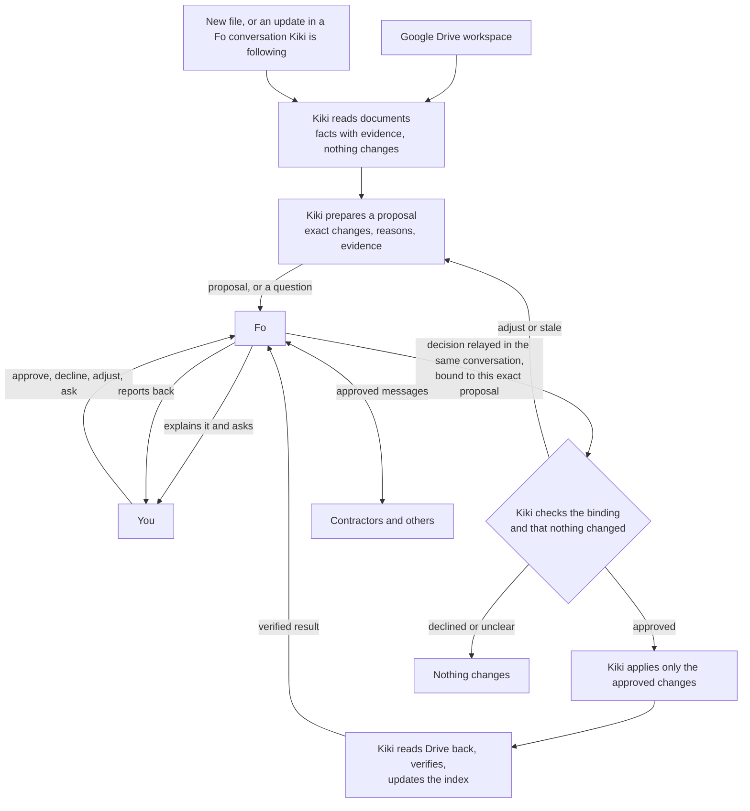

# Kiki roadmap

## Goal

Help a person or a small business find the right document, and know which version is current, without maintaining their Drive by hand. Kiki keeps a workspace organized as work happens; Fo is who the user talks to. Kiki does the document work and brings only the decisions that need the user, through Fo.

Kiki organizes anything readable (business paperwork, school and research files, work projects, personal documents). The renovation paperwork of the author's parents is the first real use case, not the boundary.

## How it works

- **Application code controls** folder bounds, approvals, execution, retries and saved progress. **The model interprets** document contents, relationships and what changed. **Drive is the evidence**: Kiki reads files back before saying anything is done.
- Fo's MCP has no webhooks yet, and a text reply starts a separate Fo conversation (Lukas, Wajo). So for now the user answers Fo **inside Kiki**: Kiki shows Fo's question and sends the answer with `ask_fo` on the same `conversationId`. A decision counts only as a `KIKI-DECISION` report from Fo bound to the request id, plan and content hash. SMS and voice approval come later, once a reply can be reliably tied to its request.

## Steps

Each step is done only when its acceptance check passes against what actually happens (in Drive, or the fake Drive in tests), not when Kiki says it worked. One step at a time; the user reviews each result before the next starts.

| # | Step | Accepted when | Status |
| --- | --- | --- | --- |
| 1 | **Understand a folder** | Kiki reads documents of every kind and shows type, issuer, project, date and title with the line that supports each; unclear files are flagged; nothing changes; no invented facts on the evaluation set. | Done: [results](evals/step-1-reading.md) |
| 2 | **Propose an organization** | For mixed folders, Kiki proposes exact names and destinations with reasons, groups related files into the same collection, reuses the user's existing folders, and never proposes touching anything outside the workspace. Measured on a set of folders with expected destinations. | Done: [results](evals/step-2-organize.md) |
| 3 | **Fo brings the proposal to you** | Fo explains the exact proposal; your answer inside Kiki (approve, decline, adjust, question) comes back linked to it; anything unbound, stale or ambiguous approves nothing. | Done: [results](evals/step-3-decisions.md) |
| 4 | **Apply and verify** | Only the approved version runs; Drive is read back; partial failures stay visible and resumable; replays and restarts make no duplicates; undo works where nothing changed since. | Done: [results](evals/step-4-apply.md) |
| 5 | **Keep the index current** | Each entry links to the real file; current, superseded and accepted are distinct; missing and unclear documents are pointed out. | Next |
| 6 | **Notice new files** | A new file is read, matched to its collection and proposed through Fo once; filed files aren't proposed again. | |
| 7 | **Fo talks to others for you** | An approved message goes out through Fo, the reply comes back on the mapped conversation, and a revised version is found (Drive first, then Gmail), compared and proposed. | |
| 8 | **Submission** | A tight demo of one complete story in a real test Drive folder, one ambiguity resolved, and the real reason it's needed. Add Remotion's agent skill (`remotion-dev/skills`, vetted first) for the demo video then. | |

## Findings to settle in each step

Automated reviews of earlier work reported these on 2026-10-18. Their verification pass was cut off, so none is confirmed yet. When a step comes up, each one is reproduced with a test first, then fixed or dismissed.

**Step 1 (fixed):** a validity period accepted a number the line doesn't state; a reference matched part of a longer number; a passing Claude error permanently dropped facts (and first reads marked a rate-limited document failed for good).

**Step 2 (settled, see [results](evals/step-2-organize.md)):** a name the user chose is proposed back after it's applied; edits to an open proposal are dropped when a version update takes a file out of it; "don't redo what the user undid" never matches; choosing which exact copy to keep can set aside the copy the user accepted; an MD5 match alone decides an exact copy; a plan with no copies can be titled "Set aside duplicate copies"; related files land in different collections (a board deck under its event, the meeting notes under the project).

**Step 3 (settled):** document text (now also file names in the proposal Fo receives) could imitate Kiki's markers in the request to Fo; the earlier "go ahead" matching findings (a contractor's quoted words or "not sure" approving) were replaced by the bound decision protocol and must be re-checked against it; "Text me a summary" can send nothing; a failed text can show as still sending; the pairing code can stay on screen after pairing; a document Kiki can't place only gets a note in the app, and Fo can't ask you where it goes.

**Step 4 (settled):** a retry can rewrite an index file the user edited or moved out of the workspace; "Refresh the plan" on a stale undo or update proposes an unrelated plan; a collapsed plan counts a skipped step as unverified; a project can be inferred from any folder under Renovations.

**Step 5:** "This is the current one" can supersede a sibling instead of the quote it replaces, and leaves an open contractor update asking; re-sending the same answer can hide a partial update; an exact copy of a revision candidate is filed as an ordinary quote; two files that read alike collapse and hide an acceptance; the index's "not in the folder" note counts files that left; "Got it" can't dismiss an item about many documents; the same-document item claims different content when Kiki can't tell.

**Step 6:** a background pickup can overwrite a choice made at the same moment; an update whose job gave up stays "reading" and holds its file; a Fo question that also says the quote isn't final holds a file indefinitely; "None of these" is forgotten when the same answer arrives again; documents already being asked about aren't held back from "Needs a look".

**Step 7:** Gmail results aren't checked against the sender's address (display-name spoofing), saved attachments are keyed by Gmail's changing attachment id and bound to a list position, and two overlapping saves can make two copies; a copy request shows "Applied and verified" when only its filing is pending, treats any Fo message as the contractor's answer, can turn into a revised-quote proposal, and closes when a revision (not the copy) arrives; an unsent request stays up after the copy lands; one open message per document blocks a second request; retrying after "Not now" returns a 500; a single candidate with an unreadable issuer is still proposed.
